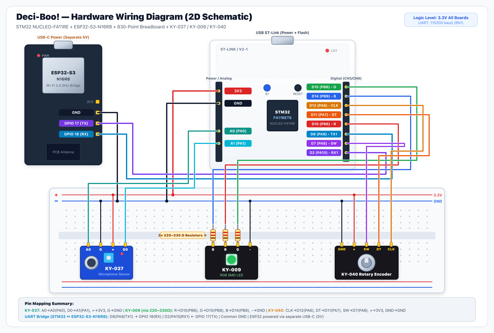

# Deci-Boo! — Hardware Wiring & System Documentation (Draft)

> เอกสารฉบับร่างสำหรับใช้จัดทำ Final Project Report (Word / Google Docs) แยกจากบันทึกความคืบหน้ารายสัปดาห์  
> *(หมายเหตุ: ส่วน Cloud / Internet Integration เว้นเป็น Placeholder ไว้สำหรับอัปเดตในขั้นตอนถัดไป)*

---

## 1. รายการอุปกรณ์หลัก (Bill of Materials)

| ลำดับ | อุปกรณ์ | รุ่น / โมดูล | หน้าที่ในระบบ |
|---|---|---|---|
| 1 | **Main MCU** | `STM32 NUCLEO-F411RE` (`STM32F411RET6`) | อ่านค่าเซนเซอร์ ประมวลผลเสียง/โหมดเกม และขับสี RGB LED |
| 2 | **Wi-Fi Bridge MCU** | `ESP32-S3-N16R8` (`DevKitC-1`) | รับ–ส่งข้อมูลกับ STM32 ผ่าน UART และให้บริการ Web Dashboard / Game UI ผ่าน Wi-Fi 2.4 GHz |
| 3 | **Microphone Sensor** | `KY-037` | ตรวจจับระดับความดังเสียงรอบโต๊ะทำงานและเสียงคำรามในเกม (`A0` Analog + `D0` Digital) |
| 4 | **RGB SMD LED** | `KY-009` | แสดงสถานะสีไฟด้วย Hardware PWM (`TIM4`) |
| 5 | **Rotary Encoder + Switch** | `KY-040` | หมุนปรับค่า Threshold และกดปุ่ม `SW` เพื่อรีเซ็ตเกณฑ์หรือเริ่มตาเกม |
| 6 | **Current-Limiting Resistors** | `220Ω–330Ω` (3 ตัว) | จำกัดกระแสเข้าขา `R`, `G`, `B` ของ `KY-009` บนแรงดัน `3.3V` |
| 7 | **Breadboard & Jumper Wires** | Breadboard 830 รู (1 อัน) | เชื่อมรางไฟ `3.3V` / `GND` ร่วมและติดตั้งโมดูลเซนเซอร์ |

---

## 2. แผนผังการต่อสายไฟ (Hardware Wiring Diagram)

*(ไฟล์เวกเตอร์ต้นฉบับสำหรับขยายชัดในรายงาน: [`wiring_diagram.svg`](images/wiring_diagram.svg))*

### 2.1 ระบบไฟเลี้ยงและกราวด์ร่วม (Power & Common Ground)
- `NUCLEO-F411RE (3V3)` → ราง `+` ของ Breadboard → เลี้ยงไฟขา `+` ของ **`KY-037`** และ **`KY-040`**
- `NUCLEO-F411RE (GND)` → ราง `-` ของ Breadboard → เชื่อมขา `-` / `GND` ของ **`KY-037`**, **`KY-009`**, **`KY-040`**, และ **`ESP32-S3-N16R8 (GND)`** เข้าด้วยกันทั้งหมด
- **`ESP32-S3-N16R8`** ใช้สาย **USB-C แยก** สำหรับเลี้ยงไฟ `5V` *(ไม่ดึงไฟ `3V3` จากบอร์ด Nucleo มาเลี้ยง ESP32 เพื่อป้องกันไฟตกช่วงส่งสัญญาณ Wi-Fi)*

### 2.2 ตารางเชื่อมต่อขาอุปกรณ์ทั้งหมด (Pin Mapping Table)

#### A. ฝั่งเซนเซอร์และเอาต์พุตบน `NUCLEO-F411RE`

| อุปกรณ์ | ขาบนโมดูล | ขาบน Nucleo (Header) | ขาชิป / Peripheral | หน้าที่ |
|---|---|---|---|---|
| **`KY-037`** (Mic) | `+` | `3V3` *(ผ่าน Breadboard)* | Power | ไฟเลี้ยง `3.3V` |
| | `G` | `GND` *(ผ่าน Breadboard)* | Ground | กราวด์ร่วม |
| | `A0` | **`A0`** | `PA0` (`ADC1_IN0`) | สุ่มอ่าน Peak-to-Peak (`50 ms` window) |
| | `D0` | **`A1`** | `PA1` (`GPIO_Input`) | อ่านสัญญาณ Digital Comparator |
| **`KY-009`** (RGB LED) | `-` | `GND` *(ผ่าน Breadboard)* | Ground | Common Cathode |
| *(ผ่าน R `220Ω–330Ω`)* | `R` | **`D10`** | `PB6` (`TIM4_CH1`) | ขับสีแดง (PWM `1 kHz`, `ARR=999`) |
| *(ผ่าน R `220Ω–330Ω`)* | `G` | **`D15`** | `PB8` (`TIM4_CH3`) | ขับสีเขียว (PWM `1 kHz`, `ARR=999`) |
| *(ผ่าน R `220Ω–330Ω`)* | `B` | **`D14`** | `PB9` (`TIM4_CH4`) | ขับสีน้ำเงิน (PWM `1 kHz`, `ARR=999`) |
| **`KY-040`** (Encoder) | `+` | `3V3` *(ผ่าน Breadboard)* | Power | ไฟเลี้ยง `3.3V` |
| | `GND` | `GND` *(ผ่าน Breadboard)* | Ground | กราวด์ร่วม |
| | `CLK` | **`D12`** | `PA6` (`TIM3_CH1`) | นับพัลส์การหมุน (`Encoder Mode TI12`, Filter `15`) |
| | `DT` | **`D11`** | `PA7` (`TIM3_CH2`) | ตรวจสอบทิศทางการหมุน |
| | `SW` | **`D7`** | `PA8` (`GPIO_Input Pull-up`) | ปุ่มกด Active-Low (รีเซ็ต Threshold / เริ่มตาเกม) |

#### B. การเชื่อมต่อ UART ระหว่าง `STM32` ↔ `ESP32-S3-N16R8` (`115200` baud, `8N1`)

| ต้นทาง | ทิศทาง | ปลายทาง | หน้าที่ |
|---|---|---|---|
| `NUCLEO D8` (`PA9` / `USART1_TX`) | → | `ESP32-S3 GPIO 18` (`Serial1 RX`) | ส่งค่าความดัง (`STAT`), ผลรอบเกม (`RES`), การกดปุ่ม (`BTN`) |
| `NUCLEO D2` (`PA10` / `USART1_RX`) | ← | `ESP32-S3 GPIO 17` (`Serial1 TX`) | ส่งคำสั่งเปลี่ยน Threshold (`SET_TH`), สลับโหมดเกม (`GAME`), คุมไฟ (`LED`), เริ่มจับเสียง (`ROAR`) |
| `NUCLEO GND` | ↔ | `ESP32-S3 GND` | กราวด์อ้างอิงร่วมสำหรับสัญญาณ UART `3.3V` |

---

## 3. สถาปัตยกรรมซอฟต์แวร์และการสื่อสาร (Software & UART Protocol)

1. **Firmware ฝั่ง STM32 ([`firmware/stm32/test_ky/Core/Src/main.c`](../firmware/stm32/test_ky/Core/Src/main.c)):**
   - **โหมดเริ่มต้น (`game_mode = 0` — Smart Noise Monitor):**
     - แบ่งระดับเสียงเป็น 3 ช่วง: เงียบ (`amp < alert_th / 2` → เขียว), เริ่มดัง (เหลือง), ดังเกินเกณฑ์ (`amp >= alert_th` → แดงกระพริบ)
     - หมุน `KY-040` ปรับค่า `alert_th` (`100–4000`, ขั้นละ `25`), กด `SW` เพื่อรีเซ็ตเป็น `400`
   - **โหมดเกม (`game_mode = 1` — Roar Games):**
     - เว็บควบคุมสีไฟ `KY-009` ตามจังหวะ (`LED,Y`, `LED,F` fade 3 วินาที, `LED,G`, `LED,R`, `GLED_LISTEN`)
     - เมื่อได้รับคำสั่ง `ROAR,<th>,<ms>` จะจับค่า `peak` และเวลารวมที่ดังเกินเกณฑ์ (`hold_ms >= 200 ms` เพื่อป้องกันเสียงกระทบสั้นๆ) แล้วส่งผล `RES,<peak>,<hold_ms>,<pass>` กลับทาง `USART1`
     - การกดปุ่ม `SW` บน `KY-040` จะส่ง `BTN` ขึ้นไปเริ่มตาถัดไปบนหน้าเว็บ

2. **Firmware ฝั่ง ESP32-S3 ([`firmware/esp32/deci_boo_bridge/deci_boo_bridge.ino`](../firmware/esp32/deci_boo_bridge/deci_boo_bridge.ino)):**
   - เชื่อมต่อ Wi-Fi 2.4 GHz และทำหน้าที่เป็น HTTP Web Server (`/` สำหรับ Roar Games, `/dash` สำหรับ Focus Dashboard)
   - แปลงข้อความจาก `Serial1` เป็น JSON API (`/api/status`) และส่งต่อคำสั่งจากเว็บ (`/api/set`, `/api/cmd`) กลับลง UART ไปยัง STM32

---

## 4. การเชื่อมต่อ Cloud & Internet (`[TODO — ส่วนถัดไป]`)

- `[TODO]` ระบุแพลตฟอร์ม Cloud ที่เลือกใช้ (เช่น **NETPIE 2020 (MQTT)** หรือ **Firebase Realtime Database**)
- `[TODO]` อธิบายโครงสร้างข้อมูลที่ส่งจาก `ESP32-S3` ขึ้น Cloud (เช่น ค่าความดัง Real-time, ผลการเล่น / Global Leaderboard, และการสั่งควบคุมระยะไกลผ่านอินเทอร์เน็ต)
- `[TODO]` แนบภาพหน้าจอ Cloud Dashboard และผลการทดสอบการเชื่อมต่อผ่านอินเทอร์เน็ต
